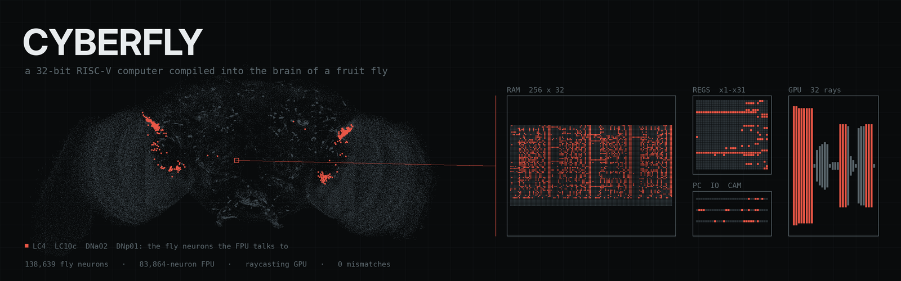

<p align="center">
  
</p>

<p align="center"><b>A 32-bit RISC-V computer, compiled into spiking neurons and wired into the connectome of a fruit fly.</b></p>

<p align="center">
  <a href="#quickstart">Quickstart</a> ·
  <a href="#how-it-works">How it works</a> ·
  <a href="#whats-real-and-what-we-added">Real vs added</a> ·
  <a href="#citing">Citing</a>
</p>

---

<!-- video: shooter -->
<p align="center"><i>video coming soon: the fly playing a raycast shooter</i></p>

## What it is

cyberfly takes a small RISC-V processor written in Verilog, synthesizes it to logic gates, and compiles every gate and every bit of memory into leaky integrate-and-fire neurons using the same neuron model and parameters as the whole-brain *Drosophila* model of Shiu et al. (2024). We call the result the **FPU**, the Fly Processing Unit.

The FPU is inserted into the FlyWire v783 connectome (138,639 neurons) and simulated together with it. It does not replace any part of the brain. It writes into real visual projection neurons (LC10c, LC4) and reads real descending neurons (DNa02, DNp01). Signals between the two travel through the fly's own wiring: in the shooter, the GPU's frame is drawn onto the fly's visual neurons and the fly's descending neurons are the joystick.

- **FPU:** RV32I, 1 KiB of RAM, one memory-mapped port. 16,215 gates and 1,154 flip-flops become 83,864 neurons.
- **GPU:** a 32-column raycaster in the same neurons. FPU plus GPU is 186,381 neurons.
- **Firmware:** plain C compiled with clang. Included are a raycast shooter, Fibonacci, and a zigzag walk.
- **Body:** a FlyGym/MuJoCo fly whose compound eyes feed the connectome and whose descending neurons drive the legs.

Every neural run is checked cycle by cycle against a gate-level simulation and an instruction-set simulator. All rv32ui conformance tests pass on the synthesized netlist, and the spiking FPU matches the gate-level model with 0 mismatches.

## How it works

```
  C source ──clang──▶ RV32I binary ─────────────────────────────┐
                                                                 ▼
  Verilog ──yosys──▶ NOR / NOT / DFF netlist ──compiler──▶ LIF neurons ──┐
                                                                         │ inserted into
                      ┌──────────────────────────────────────────────────▼───────────┐
                      │                 FlyWire v783 connectome                       │
   FPU io_out ──▶     │  followers ─▶ LC10c, LC4 ─▶ ... brain ... ─▶ DNa02, DNp01 ─┐  │
   compound eyes ──▶  │  ommatidia ─▶ LC10c, LC4                                   │  │
                      └────────────────────────────────────────────────────────────┼──┘
                                         FPU io_in  ◀── capture neurons ◀──────────┤
                                         FlyGym legs (turn, walk)  ◀── DNa02 rate ─┘
```

**Gates as neurons.** Every logic gate is a NOR, built by veto. A ring of clock neurons cycles through M phases (132 for the FPU). On its phase, a gate neuron receives an excitatory kick from the ring (weight 242) that makes it fire unless one of its inputs, wired with weight −242, fires at the same time. Fan-out above 400 is split across copies. The compiler schedules each gate into a phase after its inputs settle, ASAP then ALAP, and adds taps where a signal has to wait.

**Memory as neurons.** A flip-flop is a pair of mutually inhibiting neurons, A and B, that refire every other phase: A firing means 1, B firing means 0. A write schedule sets or resets each latch at a fixed phase. The 256×32 RAM is a macro of 8,192 latch pairs with neural address decoding.

**Timing.** All neurons use the Shiu LIF parameters (v₀ −52 mV, threshold −45 mV, membrane 20 ms, synapse 5 ms, refractory 2.2 ms, delay 1.8 ms, dt 0.1 ms). One phase is 49 steps (4.9 ms), so one FPU cycle is 132 phases, or 0.647 s of simulated brain time.

**Talking to the brain.** While an output bit is 1, its follower neurons fire every other phase and excite a group of LC10c and LC4 neurons, split by side. The shooter maps its 32 screen columns this way; the walk program uses 12 bits of `io_out`. On the way back, DNa02 left and right and DNp01 (the giant fiber) excite capture neurons on `io_in`, which the FPU samples once per cycle. In the embodied run, the fly's eyes are 2×721 ommatidia rendered by FlyGym; each fires at a rate set by how dark it sees and excites two LC10c neurons on its side and sometimes an LC4. The difference in DNa02 firing rate between the two sides sets the turn.

**Checking it.** The same netlist runs three ways: the instruction-set simulator in `iss.py`, the gate-level evaluator in `logic.py`, and the spiking network in `lif.c`. The tests assert that all three agree.

## Quickstart

You need [uv](https://docs.astral.sh/uv/) and clang/lld with the RISC-V target (any recent LLVM).

```bash
git clone https://github.com/bodow1/cyberfly && cd cyberfly
uv sync
uv run pytest
```

The tests synthesize the FPU and GPU, run C programs on the ISS, the gate model and the spiking FPU, and need no connectome data. To run the official rv32ui suite as well:

```bash
git clone https://github.com/riscv-software-src/riscv-tests
RISCV_TESTS=$PWD/riscv-tests uv run pytest tests/test_fpu.py::test_rv32ui
```

To run the FPU inside the fly, download the connectome (about 420 MB, into `~/.cache/cyberfly/data`, or set `CYBERFLY_DATA`):

```bash
uv run python -m cyberfly.connectome
```

Brain-only shooter: the GPU renders the maze onto LC neurons, and DNa02 and DNp01 come back as the controls. Each cycle is checked against the gate model.

```bash
uv run python examples/shooter.py --cycles 200
```

Embodied: a simulated fly walks a zigzag under FPU control.

```bash
uv sync --extra body
uv run python examples/walk.py --seconds 20
```

Both examples accept `--gpu` (`uv sync --extra gpu`, CUDA 12). Full-length runs with the connectome are practical only on a GPU.

<!-- video: walk -->
<p align="center"><i>video coming soon: the fly walking under FPU control</i></p>

## What's real and what we added

| Real | Added by us |
| --- | --- |
| FlyWire v783 connectome: 138,639 neurons and their synapses | The FPU and GPU neurons, 83,864 to 186,381 of them |
| Shiu et al. LIF model and every parameter | The clock ring, NOR-by-veto gates and latch pairs |
| Cell types and positions from FlyWire annotations | Synapses from FPU follower neurons onto LC10c and LC4 |
| Every path from LC10c and LC4 through the brain to DNa02 and DNp01 | Synapses from DNa02 and DNp01 onto FPU input capture neurons |
| FlyGym body, physics and compound-eye rendering | Random wiring from ommatidia to LC neurons, and the DNa02-to-turn mapping |

The FPU's synapses use the same weights and delays as real synapses in the model, but their pattern is engineered: the circuit does not exist in any fly. The eye-to-LC and descending-to-leg mappings are simplifications, not measured anatomy. The project asks whether a connectome-scale spiking model can host an exact digital computer and pass signals through real cell types; it makes no claim about how flies compute.

## Layout

```
hw/          Verilog: fpu.v (RV32I core), gpu.v (raycaster), top.v, neural.v
cyberfly/    hdl (yosys), logic (gate sim), neurons + compiler (gates to LIF),
             lif.c / lif_gpu.py (spiking sim), runtime, iss, raycaster,
             connectome, brain, body, firmware
firmware/    crt0, runtime, shooter.c, fib.c, zigzag.c
examples/    shooter.py, walk.py
tests/       neurons, fpu (incl. rv32ui), gpu
```

## Citing

```bibtex
@software{cyberfly2026,
  author = {bodow1},
  title  = {cyberfly: a RISC-V computer compiled into the fruit fly connectome},
  year   = {2026},
  url    = {https://github.com/bodow1/cyberfly}
}
```

This work rests on:

- Shiu, P. K. et al. A *Drosophila* computational brain model reveals sensorimotor processing. *Nature* 634, 210–219 (2024).
- Dorkenwald, S. et al. Neuronal wiring diagram of an adult brain. *Nature* 634, 124–138 (2024).
- Schlegel, P. et al. Whole-brain annotation and multi-connectome cell typing of *Drosophila*. *Nature* 634, 139–152 (2024).
- Wang-Chen, S. et al. NeuroMechFly v2: simulating embodied sensorimotor control in adult *Drosophila*. *Nature Methods* 21, 2353–2362 (2024).

## License

The code is MIT; see [LICENSE](LICENSE).

The connectome is not included. `cyberfly.connectome` downloads it from [philshiu/Drosophila_brain_model](https://github.com/philshiu/Drosophila_brain_model) and [flyconnectome/flywire_annotations](https://github.com/flyconnectome/flywire_annotations). FlyWire data is subject to the [FlyWire terms](https://codex.flywire.ai/about_flywire), which include citing the FlyWire papers above in any publication that uses it.
