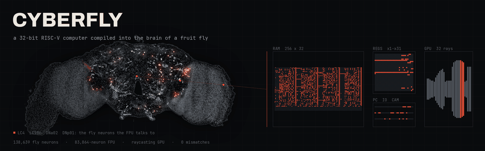
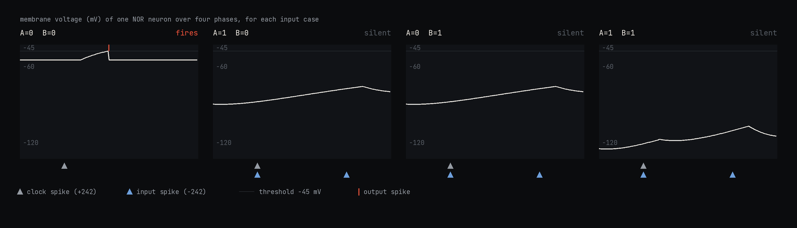
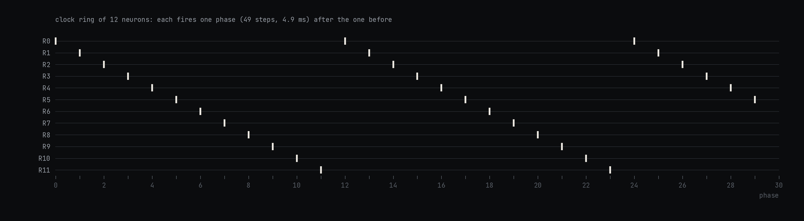
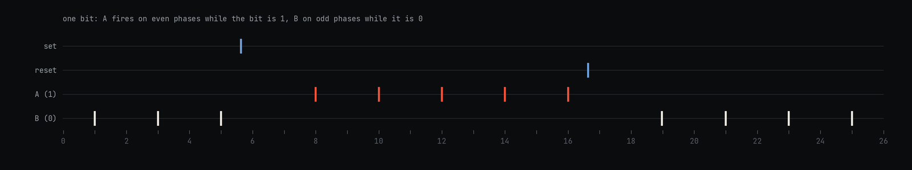
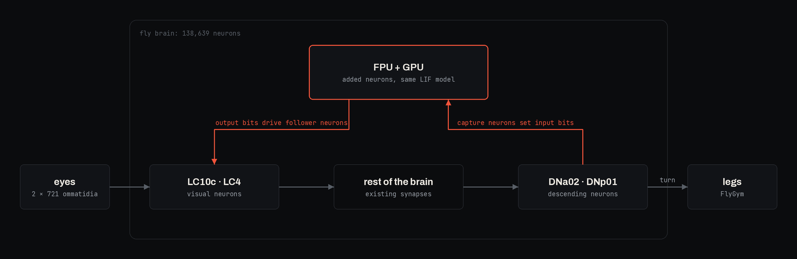

<p align="center">
  
</p>

<p align="center"><b>A 32-bit RISC-V computer, compiled into spiking neurons and wired into the connectome of a fruit fly.</b></p>

---

## What it is

cyberfly is a small computer built out of simulated neurons and placed inside a simulated fruit fly brain.

The brain is the FlyWire connectome: a map of all 138,639 neurons in an adult *Drosophila* brain and the synapses between them. Shiu et al. (2024) turned this map into a simulation in which every neuron is a leaky integrate-and-fire (LIF) neuron: it adds up its inputs, leaks back toward rest, and fires a spike when its voltage crosses a threshold.

The computer is a 32-bit RISC-V processor, called the FPU (Fly Processing Unit). It is written in Verilog, a language for describing digital circuits, and compiled into LIF neurons with the same model and parameters as the fly's own. Its output bits excite real visual neurons in the fly brain, and real descending neurons, which carry commands from the brain to the body, write its input bits. Programs are written in C.

- FPU: RV32I instruction set, 1 KiB of RAM. 83,864 neurons.
- GPU: a raycaster that renders a 32-column view of a maze. FPU and GPU together are 186,381 neurons.
- Radio: one transmit neuron and one receive neuron. A bootloader receives new programs over it.
- Learning: a neuron in the fly's mushroom body learns from reward when to call the FPU.
- Body: a simulated fly in FlyGym, whose eyes feed the brain and whose descending neurons steer it.

Inspired by [Qwenputer](https://github.com/divagr18/qwenputer).

## How it works

### A neuron as a logic gate

Every logic gate in the FPU is a NOR gate: its output is 1 only when all of its inputs are 0. A NOR gate is one neuron with two kinds of input. A clock neuron excites it with a synapse of weight +242. Each logic input inhibits it with a synapse of weight −242. One synapse of weight 1 moves the voltage by 0.275 mV, so +242 is enough to make the neuron fire by itself.

The clock spike and the input spikes arrive in the same 0.1 ms time step. If no input fires, the clock spike drives the neuron over threshold and it fires: output 1. If any input fires, the inhibition cancels the clock spike and the neuron stays silent: output 0. A spike means 1 and silence means 0.

<p align="center"></p>
<p align="center"><sub>Voltage of one NOR neuron in the simulator for all four input cases. Only A=0, B=0 crosses the threshold.</sub></p>

NOT is a NOR with one input. Any digital circuit can be built from NOR gates.

### The clock

The neurons are timed by a ring of clock neurons. Each one excites the next, so a single spike travels around the ring. The time from one ring neuron firing to the next is one phase: 49 time steps, or 4.9 ms. The FPU's ring has 132 neurons, so one full turn, one FPU clock cycle, takes 132 phases or 0.647 s.

<p align="center"></p>
<p align="center"><sub>A ring of 12 clock neurons in the simulator. The FPU uses the same ring with 132 neurons.</sub></p>

Every gate is assigned a phase. It receives its clock spike from the ring neuron of the phase before, so it can only fire on its own phase. A gate's inputs must fire one or two phases earlier. The compiler assigns phases so that every gate comes after the gates that feed it. A ring neuron can drive at most 400 others, so busy phases get copies of their clock neuron.

### Memory

A gate forgets its output after one phase. A flip-flop, which holds one bit for as long as needed, is a pair of neurons, A and B. A fires on even phases and B on odd phases, and each inhibits the other. When the bit is 1, A fires and keeps B silent. When it is 0, B fires and keeps A silent. A spike from a set neuron silences B once, and A takes over. A spike from a reset neuron silences A once, and B takes over.

<p align="center"></p>
<p align="center"><sub>One bit in the simulator. A set spike switches it from 0 to 1, and a reset spike switches it back.</sub></p>

The FPU's registers, its program counter and its 256 × 32-bit RAM are all built this way. The RAM is 8,192 flip-flops plus NOR gates that decode the address.

### From Verilog to neurons

The FPU is about 160 lines of Verilog. Yosys, an open-source synthesis tool, turns it into a netlist: a list of 16,215 NOR and NOT gates and 1,154 flip-flops and the wires between them. The cyberfly compiler then:

1. assigns each gate a phase after all of its inputs,
2. creates one neuron per gate, with a clock synapse from the ring and an inhibitory synapse from each input,
3. creates one A/B pair per flip-flop, with set and reset neurons that copy the next value in at the end of the cycle,
4. builds the RAM, and stores the program by starting each RAM bit in the A or B state.

The result is 83,864 neurons. One RISC-V instruction takes two clock cycles, 1.29 s.

### The GPU

The GPU renders a first-person view of a 16 × 16 maze. The FPU writes a camera position and angle to it. For each of 32 screen columns, the GPU steps a ray forward through the maze until it hits a wall and records the distance, up to 31 steps. It also marks the columns covered by an enemy. All 32 columns run in parallel. The shooter program reads the centre column's distance to decide whether to walk or turn, and writes where to draw the enemy.

### Wiring it into the fly

<p align="center"></p>
<p align="center"><sub>The FPU and GPU sit in the same simulation as the fly brain and connect to it through real cell types.</sub></p>

Each output bit of the FPU drives a few follower neurons. While the bit is 1, the followers fire every other phase and excite a group of LC10c and LC4 neurons, two types of visual projection neurons. In the shooter, the GPU's 32 enemy columns drive 32 such groups, left columns into the left side of the brain and right columns into the right.

From there, the signal travels through the fly's own synapses. DNa02 and DNp01 are descending neurons: DNa02 steers walking left or right, and DNp01, the giant fibre, triggers escape. Their spikes excite capture neurons that set bits 0 to 2 of the FPU's input port, which the FPU reads with an ordinary load instruction.

In the embodied run, FlyGym renders what the fly sees on its 2 × 721 ommatidia, the facets of its compound eyes. Each ommatidium excites two LC10c neurons on its side, and sometimes an LC4 neuron, at a rate set by how dark it sees. The difference between left and right DNa02 firing sets the turn of the simulated body.

### The radio

The radio adds 243 neurons. To send, the program stores a 14-bit value with bit 31 set. In the next cycle, 15 gated neurons fire onto a single antenna neuron: a start spike, then one spike for each 1 bit, 6 phases apart. To receive, a single neuron feeds a chain of relay neurons that samples each 6-phase slot, writes the bits into flip-flops, and sets a valid bit. The program reads the frame and stores bit 30 to clear it.

`firmware/boot.c` walks a short zigzag, sends `?`, and waits. The host decodes the `?` from the antenna neuron's spikes, asks a language model for a walking program, compiles it, and sends it back as spikes on the receive neuron: a header, three frames per 32-bit word, and a checksum. The bootloader writes the words into RAM at 0x200 and jumps there. A 36-word program takes 110 frames and 5,528 cycles.

### Learning to call the computer

MBON09 is a mushroom body output neuron. The mushroom body is the fly's centre for learned associations. In the steering wiring, MBON09 spikes set input bit 3, so MBON09 firing is a call to the FPU.

MBON09 has two kinds of input that can change. The first is its synapses from Kenyon cells, the mushroom body's main neurons. The second is synapses from a small sign reader: neurons whose weights were trained offline to classify FlyGym renders of signs. Pixel neurons for the ommatidia drive both the reader and the visual neurons that feed the Kenyon cells.

On each trial, the fly sees one sign for 0.5 s. If MBON09 fires, every changeable synapse onto it changes by

```
dw = 0.05 · gain · (reward − 0.3 − 0.2) · min(pre spikes, 10) · min(MBON09 spikes, 3)
```

The reward is 1 for an arrow sign and 0 for a stone, a blank board or nothing. Kenyon cell synapses can only weaken, reader synapses have gain 40, and all weights are bounded. MBON09 also fires spontaneously at 2 Hz, so the untrained fly sometimes calls on everything. This is a three-factor rule: a synapse changes only when its input fired, MBON09 fired, and a reward signal arrived, the role dopamine plays in the fly's mushroom body.

### Testing

The tests run the same programs on three models and compare them cycle by cycle: an instruction-set simulator written in Python, the gate netlist, and the spiking neurons. They also run the RISC-V rv32ui conformance suite on the netlist, load a program through the bootloader, echo a frame through the radio neurons, and train a small call circuit with real and with shuffled reward.

## Quickstart

You need [uv](https://docs.astral.sh/uv/) and clang/lld with the RISC-V target.

```bash
git clone https://github.com/bodow1/cyberfly && cd cyberfly
uv sync
uv run pytest
```

The tests need no connectome data. To include the rv32ui suite:

```bash
git clone https://github.com/riscv-software-src/riscv-tests
RISCV_TESTS=$PWD/riscv-tests uv run pytest tests/test_fpu.py::test_rv32ui
```

Download the connectome (about 420 MB, into `~/.cache/cyberfly/data` or `$CYBERFLY_DATA`):

```bash
uv run python -m cyberfly.connectome
```

Shooter, brain only, with every cycle checked against the gate model:

```bash
uv run python examples/shooter.py --cycles 200
```

Zigzag walk in FlyGym:

```bash
uv sync --extra body
uv run python examples/walk.py --seconds 20
```

Radio and bootloader. Set `CYBERFLY_LLM_BASE_URL`, `CYBERFLY_LLM_API_KEY` and `CYBERFLY_LLM_MODEL` for any OpenAI-compatible endpoint, or pass `--offline` for a fixed program:

```bash
uv run python examples/radio.py --request "walk a square, then rest"
```

Learning the call:

```bash
uv run python examples/learn.py --trials 240
```

Pass `--gpu` to the shooter, walk and radio examples to simulate on CUDA (`uv sync --extra gpu`).

## What's real and what we added

| Real | Added |
| --- | --- |
| FlyWire v783 connectome: 138,639 neurons and their synapses | FPU and GPU neurons, 83,864 to 186,381 of them |
| Shiu et al. LIF model and its parameters | Clock ring, NOR-by-inhibition gates and latch pairs |
| Cell types and positions from the FlyWire annotations | Follower synapses from the FPU onto LC10c and LC4 |
| Paths from LC10c and LC4 through the brain to DNa02 and DNp01 | Synapses from DNa02, DNp01 and MBON09 onto FPU capture neurons |
| Kenyon cells, MBON09 and their synapses | Pixel neurons onto mushroom body visual inputs, the sign reader, and the three-factor rule on synapses onto MBON09 |
| FlyGym body, physics and compound-eye rendering | Random ommatidium-to-LC wiring and the DNa02-to-turn mapping |
| | Radio transmit and receive neurons |

## Layout

```
hw/          fpu.v (RV32I core), gpu.v (raycaster), top.v, neural.v
cyberfly/    hdl, logic, neurons, compiler, lif.c, lif, lif_gpu, runtime, iss, raycaster,
             connectome, brain, body, radio, llm, learning, firmware
firmware/    crt0, runtime, radio.h, boot.c, echo.c, shooter.c, fib.c, zigzag.c
examples/    shooter.py, walk.py, radio.py, learn.py
data/        signs.npz (FlyGym renders of signs, used by learn.py)
docs/        banner.py, figures.py
tests/       neurons, fpu, gpu, radio, learning
```

## Citing

If you use cyberfly in your work, please cite it. GitHub's "Cite this repository" button reads [CITATION.cff](CITATION.cff); in BibTeX:

```bibtex
@software{wirth2026cyberfly,
  author  = {Wirth, Bodo and Kannan, Naveen},
  title   = {{cyberfly}: a computer compiled into the brain of a fruit fly},
  year    = {2026},
  version = {0.1.0},
  url     = {https://github.com/bodow1/cyberfly},
  license = {MIT}
}
```

Upstream work:

- Shiu, P. K. et al. A *Drosophila* computational brain model reveals sensorimotor processing. *Nature* 634, 210–219 (2024).
- Dorkenwald, S. et al. Neuronal wiring diagram of an adult brain. *Nature* 634, 124–138 (2024).
- Schlegel, P. et al. Whole-brain annotation and multi-connectome cell typing of *Drosophila*. *Nature* 634, 139–152 (2024).
- Wang-Chen, S. et al. NeuroMechFly v2: simulating embodied sensorimotor control in adult *Drosophila*. *Nature Methods* 21, 2353–2362 (2024).
- Aso, Y. & Rubin, G. M. Dopaminergic neurons write and update memories with cell-type-specific rules. *eLife* 5, e16135 (2016).
- Hige, T., Aso, Y., Modi, M. N., Rubin, G. M. & Turner, G. C. Heterosynaptic plasticity underlies aversive olfactory learning in *Drosophila*. *Neuron* 88, 985–998 (2015).
- Li, F. et al. The connectome of the adult *Drosophila* mushroom body provides insights into function. *eLife* 9, e62576 (2020).
- Agrawal, D. Qwenputer: a computer compiled into the weights of a pretrained language model (2026). https://github.com/divagr18/qwenputer

## License

The code is MIT. The FlyWire connectome is downloaded rather than included and is subject to the [FlyWire terms](https://codex.flywire.ai/about_flywire).
