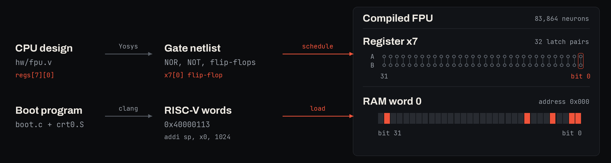
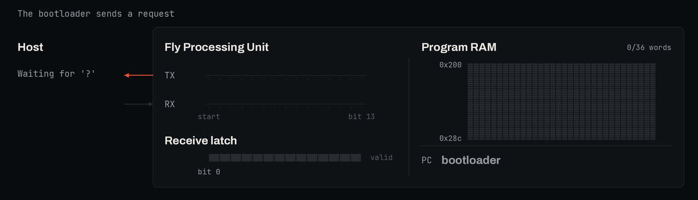
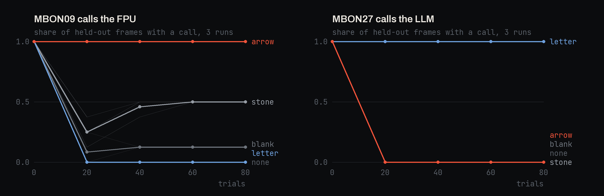

<p align="center">
  
</p>

Cyberfly is a small computer built out of simulated neurons and wired into a simulated fruit fly brain.

The brain is the FlyWire connectome, a map of 138,639 neurons in an adult *Drosophila* brain and the synapses between them. Shiu et al. (2024) turned this map into a simulation in which every neuron is a leaky integrate-and-fire (LIF) neuron, which adds up its inputs, leaks back toward rest and fires a spike when its voltage crosses a threshold.

The computer is a 32-bit RISC-V processor, which we call the FPU (Fly Processing Unit), with 1 KiB of RAM. It is compiled into 83,864 LIF neurons that use the same model and parameters as the fly's own. Its output bits excite visual neurons in the fly brain, and descending neurons, which carry commands from the brain to the body, write its input bits, so programs on the FPU can show the fly things and read what it decides to do. We found that showing it the right things is enough to steer where it walks and when it takes off. Next to the FPU sits an optional GPU that renders a 3D maze, bringing the computer to 186,381 neurons. The shooter sends the enemy's screen position to the fly's visual neurons and reads its steering and firing signals.

The fly also has a body. In FlyGym a simulated fly sees through its compound eyes and is steered by its descending neurons, and the FPU turns it by measured angles, follows arrow signs to food, adds numbers written on signs and walks or flies the shape of a digit. A pair of radio neurons lets the FPU exchange messages with the outside world, for example API calls to language models, and a language model can even send it a whole new program through a bootloader. In a separate experiment, mushroom body neurons learn when to signal a call to the FPU or to a language model, from the fly's own dopamine neurons, which the FPU excites when it can act on a call.

## How it works

### A neuron that behaves like a NOR gate

Every Boolean function can be built from NOR gates alone (Sheffer, 1913), so the first thing a computer made of neurons needs is a neuron that acts as a NOR gate. The idea that a threshold neuron can compute logic goes back to McCulloch and Pitts (1943), and networks of spiking neurons were later shown to be able to simulate Turing machines (Maass, 1996). Cyberfly does this with the LIF neuron model of Shiu et al.

We are able to use a specially wired LIF neuron for this, which we call a gate neuron. It has two kinds of input. The first is a clock neuron, which excites it through a synapse of weight +242 and acts as a timing pulse that arrives on every cycle. The second kind are the logic inputs, and each of them inhibits the gate through a synapse of weight −242. In this model each unit of synaptic weight adds 0.275 mV of synaptic drive, so the clock synapse on its own is strong enough to make the gate fire. Moreover, the clock neuron fires one phase before the gate's own phase, and the inputs fire one or two phases before it. Thus, if none of the inputs fire, the clock spike pushes the gate over the threshold and it fires, which the next gates read as a 1. If any input fires, its inhibition cancels the clock spike, the gate stays silent, and the next gates read a 0. Therefore, for two logic inputs a and b, the gate fires only when both a and b are 0. That is exactly a NOR gate, so every other Boolean function can be built from this one neuron.

<p align="center"></p>
<p align="center"><sub>Voltage of one NOR neuron in the simulator for the four input cases. Only A=0, B=0 reaches threshold.</sub></p>

### A clock

A gate fires only when its clock spike arrives, so the circuit needs a clock that tells each gate when to look at its inputs. The clock is a ring of neurons in which each neuron excites the next, so a single spike runs around the ring indefinitely. The time between one ring neuron and the next is one phase, which in this model is 49 time steps of 0.1 ms, or 4.9 ms.

<p align="center"></p>
<p align="center"><sub>A ring of 12 clock neurons in the simulator. The FPU uses a ring of 132.</sub></p>

Each gate is given a phase and takes its clock spike from the ring neuron one phase earlier. Its inputs have to fire one or two phases before it, so the compiler places every gate later in the ring than all the gates that feed it. The FPU needs 132 phases for its longest chain of gates plus the time to store the results, which makes one clock cycle 0.647 s. A ring neuron can drive at most 400 gates, so phases with more gates than that get extra copies of their clock neuron.

### Memory

A gate holds its value for one phase, and a computer has to keep registers and RAM from one cycle to the next. Each stored bit is therefore a pair of neurons, A and B, that inhibit each other. A is driven to fire on every even phase and B on every odd phase, and whichever fired last silences the other. Once A is firing, it silences B on every odd phase and B never gets to fire, and once B is firing the same is true the other way round. Thus exactly one of the two neurons keeps firing until something interrupts it. A firing stands for 1 and B firing stands for 0. A set neuron that inhibits B once hands the rhythm to A, and a reset neuron that inhibits A once hands it back to B, allowing us to flip the bit.

<p align="center"></p>
<p align="center"><sub>One stored bit in the simulator. A set spike switches it from 0 to 1, and a reset spike switches it back.</sub></p>

The FPU's 31 registers, its program counter and its 256 words of 32-bit RAM are all built from these pairs. The RAM alone is 8,192 of them, plus NOR gates that decode the address.

### Compiling the CPU

With gates, a clock and memory, a whole processor can be compiled. The FPU is a RISC-V core for the RV32I instruction set, written in about 160 lines of Verilog. Yosys, an open-source synthesis tool, turns the Verilog into a netlist of 16,215 NOR and NOT gates and 1,154 flip-flops. The Cyberfly compiler then assigns each gate a phase after all of its inputs, creates one neuron per gate with its clock and input synapses, creates an A/B pair for each flip-flop with set and reset neurons that write the next value at a fixed phase in each cycle, and builds the RAM. A program is loaded by starting each RAM bit in the A or the B state.

<p align="center"></p>

The result is 83,864 neurons. One instruction takes two clock cycles, about 1.29 s of simulated time (0.77 instructions per simulated second), and programs are written in C and compiled with clang. The table below counts where the neurons go, as printed by `docs/budget.py`.

| Part | Neurons |
| --- | ---: |
| RAM bits, 8,192 × 4 (A, B, read gate, write gate) | 32,768 |
| Delay relays and fan-out copies | 26,981 |
| CPU logic gates, including those added by the compiler | 16,311 |
| Registers and other flip-flops, with their set and reset neurons | 4,552 |
| RAM address decoding and write select | 2,856 |
| Clock ring, clock copies and oscillators | 299 |
| Input port | 97 |
| Total | 83,864 |

The RAM is the largest part, at 35,624 neurons. The CPU core, meaning its gates, delay relays and flip-flops, is 47,844 neurons. Delay relays are needed because a gate's inputs must fire one or two phases before it, so a signal that is used many phases after it was computed is passed along a chain of NOT neurons until its consumer's phase.

### The GPU (optional)

The compiler can also build a small GPU next to the CPU, which adds 102,517 neurons. `Netlist.fpu()` builds the FPU alone and `Netlist.fpu(gpu=True)` adds the GPU, which the shooter uses. The GPU differs from the CPU in that it has no program. It is fixed-function logic that renders a first-person view of a 16 × 16 maze. The FPU writes a camera position and angle to it, and then 32 ray units, one per screen column, each take one step through the maze on every clock cycle until they hit a wall, all in parallel, for at most 31 steps. Each ray unit outputs its distance, which sets the height of its column on screen, and the GPU marks the enemy columns independently of wall depth. The shooter program walks forward while the centre column's distance is more than 6 steps, turns toward the side whose DNa02 fired more, and shoots when DNp01 fires.

### Wiring it into the fly

<p align="center"></p>
<p align="center"><sub>The FPU and GPU run in the same simulation as the fly brain and connect to it through LC10c, LC4, DNa02 and DNp01.</sub></p>

The FPU and GPU neurons are added to the fly's 138,639 and simulated together with them. Each wired output bit drives a follower neuron, which fires every other phase while the bit is 1 and excites a group of LC10c and LC4 neurons, two types of visual projection neurons. In the shooter, the 32 bits of the enemy mask drive 32 such groups, with left columns going to left-side LC10c and right columns to right-side LC10c. The banner pairs an instruction-simulator replay with a separate brain simulation driven by that mask.

From there the signal travels through the fly's own synapses to DNa02 and DNp01, two types of descending neurons, which carry commands from the brain to the body. DNa02 steers walking to one side, and DNp01, the giant fibre, triggers escape. Their spikes excite capture neurons that set bits 0 to 2 of the FPU's input port, and the program reads them with an ordinary load instruction.

In the embodied run, FlyGym renders what the fly sees on the 2 × 721 ommatidia of its compound eyes. Each ommatidium excites two LC10c neurons on its side, and sometimes an LC4 neuron, at a rate set by how dark it sees, and the difference between left and right DNa02 firing sets how the simulated body turns.

### The radio

The radio lets the FPU exchange messages with the outside world through one transmit neuron and one receive neuron, using 243 extra neurons in total. To send, a program stores a 14-bit value with bit 31 set, and in the next cycle 15 gated neurons fire a start spike and then one spike for each 1 bit onto the antenna neuron, 6 phases apart. On the receiving side a chain of relay neurons samples the receive neuron in each 6-phase slot, writes the bits into flip-flops and sets a valid bit, and the program clears the frame by storing bit 30.

`firmware/boot.c` issues commands for a short zigzag, sends `?` and waits. The host decodes the `?` from the antenna neuron's spikes, asks a language model for walking actions and compiles them into RISC-V instructions. It sends the program as spikes on the receive neuron, with a header, three frames per 32-bit word and a checksum. The bootloader writes the words into RAM at address `0x200`, checks the checksum and jumps there. The animation illustrates the radio encoding for a [36-word instruction-simulator run](docs/boot_trace.json) with 110 frames and 5,560 cycles from the first frame to the jump. In a larger animal, the transmit neuron's spikes could in principle be picked up by a recording electrode or a wireless implant, so the same protocol could be used to talk to real hardware.

<p align="center"></p>

### Learning to call the computer

The FPU is useful to the fly only if something in the brain decides when to use it. Cyberfly uses MBON09 and MBON27, two output cell types of the mushroom body, the part of the fly brain that forms learned associations. MBON09 spikes set input bit 3, which is a call to the FPU, and MBON27 spikes set input bit 10, which is a call for a language model. Each call is held by a pair of latch neurons until the program on the FPU acknowledges it.

Two sets of synapses onto each of the two cell types can change. The first are their synapses from Kenyon cells, the main neurons of the mushroom body. The second come from a small sign reader, a layer of neurons whose weights were trained offline to classify FlyGym renders of signs. Pixel neurons for the ommatidia drive both the reader and the visual neurons that feed the Kenyon cells. The reader has one decision neuron for each kind of sign, and the winning one also sets one of input bits 4 to 9 through a latch that holds the latest decision, so the program can read what the fly saw after the sign is gone.

The third factor comes from the fly's dopamine neurons. The Kenyon cell axons are divided into compartments, each with its own output neurons and its own dopaminergic neurons, and the synapses from Kenyon cells onto an output neuron change when the dopamine neurons of its compartment fire (Aso and Rubin, 2016). MBON09 sits in the γ3 and β′1 compartments, which get their dopamine from PAM12 in γ3 and PAM13 and PAM14 in β′1 (Li et al., 2020), and in the FlyWire connectome these three types also make the most synapses onto MBON09. MBON27 sits in γ5, the compartment of PAM01, which is likewise the type with the most synapses onto MBON27. Output bits 12 and 13 of the FPU drive follower neurons that excite these 51 and 41 dopamine neurons, the same way the steering bits excite LC10c.

The program for this, `firmware/reward.c`, waits for a call. When MBON09 calls, it reads the held decision, and if the sign was an arrow it writes the steering command for that arrow together with bit 12. When MBON27 calls, it raises bit 13 if the sign was a letter. The reward bit stays on for one instruction, about 1.3 s, during which each dopamine neuron fires 132 times. The same store acknowledges the call, which also clears the decision the program used, so a second call on the same sign is answered without reward.

In each trial the fly sees one sign for 0.5 s, and the trial continues until the FPU has answered every call. If MBON09 or MBON27 fired, each changeable input weight onto it, in units of synapse count, is updated by

```
dw = 0.05 · gain · (D / D₁ − 0.3 − 0.2) · min(pre spikes, 10) · min(MBON spikes, 3)
```

where D is the number of spikes its dopamine neurons fired during the trial and D₁ is the number they fire for one rewarded call, measured once before training by holding a call and a matching decision in the latches. Kenyon cell synapses can only weaken, reader synapses have a gain of 40, and all weights are bounded. A weight therefore changes only when its input and the output neuron both fired, and the dopamine its compartment received in that trial decides whether it grows or weakens. The rule is inspired by dopamine plasticity in the mushroom body. Before training both cell types fire for every kind of sign, and during training they also receive spontaneous spikes at 2 Hz. The fly brain neurons are reset at the start of each trial, while the FPU keeps running.

We ran `examples/learn.py` on the full connectome for 80 trials, once for each cell type and each of three trial orders, and measured on eight held-out frames of each kind of sign whether any cell of the type fired. MBON09 went from calling on every frame to calling on 1.0 of the arrows, 0.5 of the stones, 0.125 of the blank boards and none of the letters or empty views, and it reached these rates by trial 60 in every run. MBON27 called on every letter and on nothing else from trial 20 on. A trial in which the FPU rewards a call takes about 38 s of simulated time for MBON09 and 20 s for MBON27, and one without reward about 17 s, most of it spent waiting for the program, which needs about a dozen instructions of 1.3 s each to read the call and answer it. A natural next step is a sparser reward, for example one given only when the fly reaches food, which would need each synapse to keep a trace of its activity until the reward arrives, and the fly brain model has no such trace.

<p align="center"></p>
<p align="center"><sub>Share of held-out sign frames on which MBON09 and MBON27 called during training, from <code>examples/learn.py</code> on the full connectome.</sub></p>

### Testing

The tests compare the gate netlist with the instruction simulator after each instruction of the Fibonacci and primes program. Over the first 50 CPU cycles they check the spiking FPU's monitored flip-flops against the gates every cycle and RAM every 25 cycles. They also run selected rv32ui tests on the gate netlist with external memory (skipping `fence_i` and `ma_data`), load a program through the bootloader, echo a frame through the radio neurons, train a small call circuit with dopamine that follows the sign and with shuffled dopamine, and check that the reward program excites the dopamine neurons for an arrow and not for a stone.

## Quickstart

You need [uv](https://docs.astral.sh/uv/), clang/lld with the RISC-V target, and `llvm-objcopy`.

```bash
git clone https://github.com/bodow1/cyberfly && cd cyberfly
uv sync
uv run pytest
```

The tests need no connectome data. To include the rv32ui suite, run

```bash
git clone https://github.com/riscv-software-src/riscv-tests
RISCV_TESTS=$PWD/riscv-tests uv run pytest tests/test_fpu.py::test_rv32ui
```

The shooter, walking and learning examples need the connectome, about 420 MB, which is downloaded into `~/.cache/cyberfly/data` or `$CYBERFLY_DATA`.

```bash
uv run python -m cyberfly.connectome
```

The shooter runs in the brain without a body and checks its flip-flops every cycle against the gate model.

```bash
uv run python examples/shooter.py --cycles 200
```

The zigzag walk runs in FlyGym.

```bash
uv sync --extra body
uv run python examples/walk.py --seconds 20
```

The standalone radio example requests walking actions and uploads the compiled program to the spiking FPU. Set `CYBERFLY_LLM_BASE_URL`, `CYBERFLY_LLM_API_KEY` and `CYBERFLY_LLM_MODEL` for any OpenAI-compatible endpoint, or pass `--offline` for a fixed program.

```bash
uv run python examples/radio.py --request "walk a square, then rest"
```

The learning example trains MBON09 and MBON27 and writes their call rates to `runs/learn/learn.json`, which `docs/figures.py` draws.

```bash
uv run python examples/learn.py --trials 80
```

Pass `--gpu` to the shooter, walk and radio examples to simulate on CUDA (`uv sync --extra gpu`).

## What's real and what we added

| Starting point | What we built |
| --- | --- |
| FlyWire v783 connectome with 138,639 neurons and their synapses | FPU and GPU neurons, 83,864 to 186,381 of them |
| Shiu et al. LIF model and its parameters | Clock ring, NOR-by-inhibition gates and latch pairs |
| Cell types and positions from the FlyWire annotations | Follower synapses from the FPU onto LC10c and LC4 |
| Paths from LC10c and LC4 through the brain to DNa02 and DNp01 | Synapses from DNa02, DNp01, MBON09 and MBON27 onto FPU capture and latch neurons |
| Kenyon cells, MBON09, MBON27, PAM dopamine neurons and their synapses | Pixel neurons onto mushroom body visual inputs, the sign reader, follower synapses from the FPU onto PAM neurons, and the three-factor rule on synapses onto MBON09 and MBON27 |
| FlyGym body, physics and compound-eye rendering | Random ommatidium-to-LC wiring and the DNa02-to-turn mapping |
| | Radio transmit and receive neurons |

## Layout

```
hw/          fpu.v (RV32I core), gpu.v (raycaster), top.v, neural.v
cyberfly/    hdl, logic, neurons, compiler, lif.c, lif, lif_gpu, runtime, iss, raycaster,
             connectome, brain, body, radio, ports, llm, learning, firmware
firmware/    crt0, runtime, radio.h, boot.c, echo.c, shooter.c, fib.c, zigzag.c, reward.c
examples/    shooter.py, walk.py, radio.py, learn.py
data/        signs.npz (FlyGym renders of signs, used by learn.py)
docs/        banner.py, figures.py
tests/       neurons, fpu, gpu, radio, learning
```

## Citing

Please cite Cyberfly as

```bibtex
@software{cyberfly2026,
  author  = {Wirth, Bodo and Kannan, Naveen},
  title   = {Cyberfly: a RISC-V computer in a fruit fly brain},
  year    = {2026},
  version = {0.1.0},
  url     = {https://github.com/bodow1/cyberfly}
}
```

Cyberfly builds on the following work.

- Shiu, P. K. et al. A *Drosophila* computational brain model reveals sensorimotor processing. *Nature* 634, 210–219 (2024).
- Dorkenwald, S. et al. Neuronal wiring diagram of an adult brain. *Nature* 634, 124–138 (2024).
- Schlegel, P. et al. Whole-brain annotation and multi-connectome cell typing of *Drosophila*. *Nature* 634, 139–152 (2024).
- Wang-Chen, S. et al. NeuroMechFly v2: simulating embodied sensorimotor control in adult *Drosophila*. *Nature Methods* 21, 2353–2362 (2024).
- Aso, Y. & Rubin, G. M. Dopaminergic neurons write and update memories with cell-type-specific rules. *eLife* 5, e16135 (2016).
- Hige, T., Aso, Y., Modi, M. N., Rubin, G. M. & Turner, G. C. Heterosynaptic plasticity underlies aversive olfactory learning in *Drosophila*. *Neuron* 88, 985–998 (2015).
- McCulloch, W. S. & Pitts, W. A logical calculus of the ideas immanent in nervous activity. *Bulletin of Mathematical Biophysics* 5, 115–133 (1943).
- Sheffer, H. M. A set of five independent postulates for Boolean algebras, with application to logical constants. *Transactions of the American Mathematical Society* 14, 481–488 (1913).
- Maass, W. Lower bounds for the computational power of networks of spiking neurons. *Neural Computation* 8, 1–40 (1996).
- Li, F. et al. The connectome of the adult *Drosophila* mushroom body provides insights into function. *eLife* 9, e62576 (2020).
- Agrawal, D. Qwenputer: a computer compiled into the weights of a pretrained language model (2026). https://github.com/divagr18/qwenputer

## License

Cyberfly is released under the MIT License, see [LICENSE](LICENSE). The FlyWire connectome is not part of this repository. `cyberfly.connectome` downloads it, and its use is governed by the [FlyWire terms](https://codex.flywire.ai/about_flywire).
