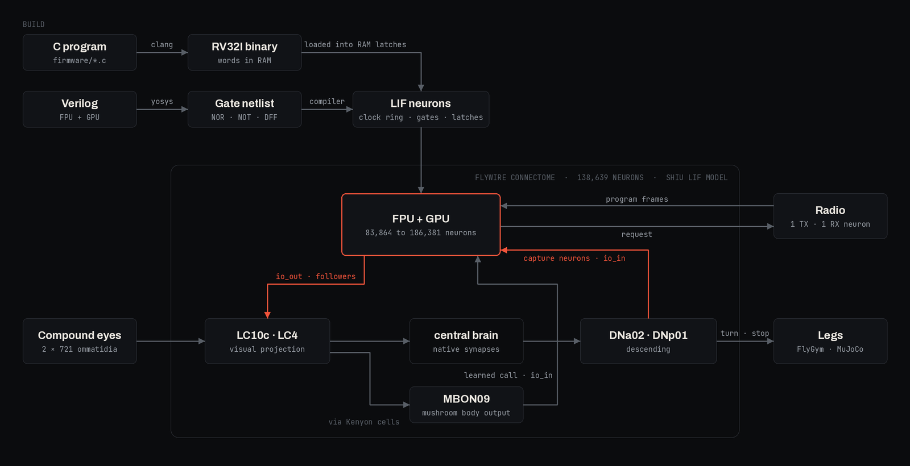

<p align="center">
  
</p>

<p align="center"><b>A 32-bit RISC-V computer, compiled into spiking neurons and wired into the connectome of a fruit fly.</b></p>

---

## What it is

cyberfly synthesizes a small RISC-V processor written in Verilog to logic gates and compiles every gate and every bit of memory into leaky integrate-and-fire neurons, using the neuron model and parameters of the whole-brain *Drosophila* model of Shiu et al. (2024). The processor is called the FPU, the Fly Processing Unit.

The FPU is simulated inside the FlyWire v783 connectome (138,639 neurons). Its output drives visual projection neurons (LC10c, LC4), and descending neurons (DNa02, DNp01) drive its input. In the shooter demo the GPU's frame is drawn onto the fly's visual neurons, and the descending neurons act as the controller.

- FPU: RV32I, 1 KiB of RAM, one memory-mapped I/O port. 16,215 gates and 1,154 flip-flops compile to 83,864 neurons.
- GPU: a 32-column raycaster. FPU and GPU together are 186,381 neurons.
- Radio: one transmit neuron and one receive neuron carry 14-bit frames, and a resident bootloader loads programs sent over it.
- Learning: a mushroom body output neuron, MBON09, learns from dopamine-like reward when to call the FPU.
- Firmware: C compiled with clang. The repo includes a raycast shooter, Fibonacci, a zigzag walk, the bootloader and an echo test.
- Body: a FlyGym/MuJoCo fly whose compound eyes feed the connectome and whose descending neurons steer it.

Inspired by [Qwenputer](https://github.com/divagr18/qwenputer).

## How it works

<p align="center">
  
</p>

### Gates

Yosys maps the design to NOR, NOT and D flip-flops. Every gate becomes one neuron. A ring of clock neurons cycles through M phases (132 for the FPU). A gate neuron receives an excitatory synapse from the clock neuron of the preceding phase (weight 242) and an inhibitory synapse (weight −242) from each of its inputs, so it fires on its phase when none of its inputs fired. The compiler places each gate in a phase after its inputs have settled, and adds relay taps where a signal has to wait. Clock neurons are copied when a fan-out exceeds 400.

### Memory

A flip-flop is a pair of neurons, A and B, that inhibit each other and refire on alternating phases. A firing means 1 and B firing means 0. Set and reset neurons write the pair at fixed phases. The 256 × 32 RAM is 8,192 such pairs with an address decoder built from the same gates.

### Timing

All neurons use the Shiu LIF parameters: resting potential −52 mV, threshold −45 mV, membrane time constant 20 ms, synaptic time constant 5 ms, refractory period 2.2 ms, synaptic delay 1.8 ms, time step 0.1 ms. One phase is 49 steps (4.9 ms). One FPU cycle is 132 phases, or 0.647 s, and one instruction takes two cycles.

### Connection to the brain

While an output bit is 1, its follower neurons fire every other phase and excite a group of LC10c and LC4 neurons. The shooter maps its 32 screen columns to 32 such groups, and the walk program uses 12 bits of `io_out`. DNa02 left, DNa02 right and DNp01 excite capture neurons on bits 0 to 2 of `io_in`, which the FPU samples once per cycle. In the embodied run the eyes are 2 × 721 ommatidia rendered by FlyGym. Each ommatidium fires at a rate set by how dark it sees and excites two LC10c neurons on its side and, with probability 0.3, one LC4 neuron. The difference between the DNa02 firing rates on the two sides sets the turn.

### Radio and bootloader

The transmitter is 15 gated neurons that fire, in the cycle after a store with bit 31 set, a start spike and one spike per set bit onto a single antenna neuron, 6 phases apart. The receiver is a single neuron followed by a relay chain that samples each bit slot by inhibition, a 14-bit holding latch and a valid latch, which are copied into `io_in` every cycle. The firmware acknowledges a frame with bit 30, which clears the holding latches. Transmitter and receiver add 243 neurons.

`firmware/boot.c` walks a short zigzag, stands, sends `?`, then reads a header frame, three frames per 32-bit word into RAM from 0x200, and a 14-bit checksum, and jumps to 0x200. In `examples/radio.py` the host decodes the `?` from the antenna neuron's spikes, asks a language model for a program as a list of walking actions, assembles it with clang, and sends it as spikes on the receive neuron. The 36-word program takes 110 frames and 5,528 FPU cycles to load.

### Learning to call the FPU

MBON09 is the call neuron. In the steering wiring its spikes excite the capture neuron of `io_in` bit 3. It receives two plastic inputs: its own synapses from Kenyon cells, and synapses from a small sign reader whose class neurons are trained offline on FlyGym renders. Pixel neurons for the 2 × 721 ommatidia also excite visual neurons that project into the mushroom body. On a trial in which MBON09 fires, each plastic synapse changes by

```
dw = eta · gain · (reward − baseline − cost) · min(pre spikes, 10) · min(post spikes, 3)
```

with eta 0.05, baseline 0.3 and cost 0.2. Kenyon cell synapses can only depress, reader synapses have gain 40, and all weights are bounded. The reward is 1 when MBON09 fired with an arrow sign in view and 0 for a stone, a blank board or nothing. Spontaneous spikes at 2 Hz make the untrained neuron call at random. `examples/learn.py` trains on the frames in `data/signs.npz` and plots the call rate on held-out frames for each kind of sign.

### Tests

The tests compare the spiking FPU, the gate-level model and the instruction-set simulator, run the rv32ui conformance suite, load a program through the bootloader, echo a frame through the radio neurons, and train a small call circuit with real and with shuffled reward.

## Quickstart

You need [uv](https://docs.astral.sh/uv/) and clang/lld with the RISC-V target.

```bash
git clone https://github.com/bodow1/cyberfly && cd cyberfly
uv sync
uv run pytest
```

The tests need no connectome data. To include the rv32ui suite:

```bash
git clone https://github.com/riscv-software-src/riscv-tests
RISCV_TESTS=$PWD/riscv-tests uv run pytest tests/test_fpu.py::test_rv32ui
```

Download the connectome (about 420 MB, into `~/.cache/cyberfly/data` or `$CYBERFLY_DATA`):

```bash
uv run python -m cyberfly.connectome
```

Shooter, brain only, with every cycle checked against the gate model:

```bash
uv run python examples/shooter.py --cycles 200
```

Zigzag walk in FlyGym:

```bash
uv sync --extra body
uv run python examples/walk.py --seconds 20
```

Radio and bootloader. Set `CYBERFLY_LLM_BASE_URL`, `CYBERFLY_LLM_API_KEY` and `CYBERFLY_LLM_MODEL` for any OpenAI-compatible endpoint, or pass `--offline` for a fixed program:

```bash
uv run python examples/radio.py --request "walk a square, then rest"
```

Learning the call:

```bash
uv run python examples/learn.py --trials 240
```

Pass `--gpu` to the shooter, walk and radio examples to simulate on CUDA (`uv sync --extra gpu`).

## What's real and what we added

| Real | Added |
| --- | --- |
| FlyWire v783 connectome: 138,639 neurons and their synapses | FPU and GPU neurons, 83,864 to 186,381 of them |
| Shiu et al. LIF model and its parameters | Clock ring, NOR-by-inhibition gates and latch pairs |
| Cell types and positions from the FlyWire annotations | Follower synapses from the FPU onto LC10c and LC4 |
| Paths from LC10c and LC4 through the brain to DNa02 and DNp01 | Synapses from DNa02, DNp01 and MBON09 onto FPU capture neurons |
| Kenyon cells, MBON09 and their synapses | Pixel neurons onto mushroom body visual inputs, the sign reader, and the three-factor rule on synapses onto MBON09 |
| FlyGym body, physics and compound-eye rendering | Random ommatidium-to-LC wiring and the DNa02-to-turn mapping |
| | Radio transmit and receive neurons |

## Layout

```
hw/          fpu.v (RV32I core), gpu.v (raycaster), top.v, neural.v
cyberfly/    hdl, logic, neurons, compiler, lif.c, lif, lif_gpu, runtime, iss, raycaster,
             connectome, brain, body, radio, llm, learning, firmware
firmware/    crt0, runtime, radio.h, boot.c, echo.c, shooter.c, fib.c, zigzag.c
examples/    shooter.py, walk.py, radio.py, learn.py
data/        signs.npz (FlyGym renders of signs, used by learn.py)
docs/        banner.py, diagram.py
tests/       neurons, fpu, gpu, radio, learning
```

## Citing

If you use cyberfly in your work, please cite it. GitHub's "Cite this repository" button reads [CITATION.cff](CITATION.cff); in BibTeX:

```bibtex
@software{wirth2026cyberfly,
  author  = {Wirth, Bodo and Kannan, Naveen},
  title   = {{cyberfly}: a computer compiled into the brain of a fruit fly},
  year    = {2026},
  version = {0.1.0},
  url     = {https://github.com/bodow1/cyberfly},
  license = {MIT}
}
```

Upstream work:

- Shiu, P. K. et al. A *Drosophila* computational brain model reveals sensorimotor processing. *Nature* 634, 210–219 (2024).
- Dorkenwald, S. et al. Neuronal wiring diagram of an adult brain. *Nature* 634, 124–138 (2024).
- Schlegel, P. et al. Whole-brain annotation and multi-connectome cell typing of *Drosophila*. *Nature* 634, 139–152 (2024).
- Wang-Chen, S. et al. NeuroMechFly v2: simulating embodied sensorimotor control in adult *Drosophila*. *Nature Methods* 21, 2353–2362 (2024).
- Aso, Y. & Rubin, G. M. Dopaminergic neurons write and update memories with cell-type-specific rules. *eLife* 5, e16135 (2016).
- Hige, T., Aso, Y., Modi, M. N., Rubin, G. M. & Turner, G. C. Heterosynaptic plasticity underlies aversive olfactory learning in *Drosophila*. *Neuron* 88, 985–998 (2015).
- Li, F. et al. The connectome of the adult *Drosophila* mushroom body provides insights into function. *eLife* 9, e62576 (2020).
- Agrawal, D. Qwenputer: a computer compiled into the weights of a pretrained language model (2026). https://github.com/divagr18/qwenputer

## License

The code is MIT. The FlyWire connectome is downloaded rather than included and is subject to the [FlyWire terms](https://codex.flywire.ai/about_flywire).
